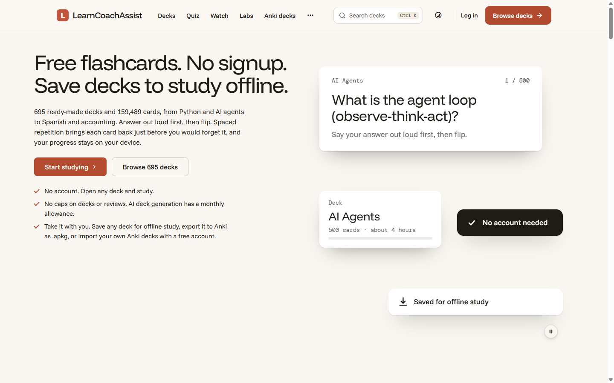

# LearnCoachAssist

**Free spaced-repetition flashcards that you can study without signing up, plus AI-generated decks on demand.**

[learncoachassist.com](https://learncoachassist.com) · [Case study](https://agicad.com/portfolio/learncoachassist/)

> The source code is private. This repository documents the product and how it is built. The scheduler is open source: [sm2-scheduler](https://github.com/toniilic/sm2-scheduler).

## The problem

The feature that sets the product apart is generating a deck on demand from any topic. Model calls are slow, sometimes come back truncated, and cost money. When generation ran inside the request, large decks timed out. When credits were charged up front, users paid for generations that failed.

## How it's built

- **Queued generation.** A queued job generates each deck. The deck row tracks its status, the user gets an ETA when they submit and an email when the deck is ready.
- **Credits reserved first.** Credits are reserved when the user submits and refunded idempotently if generation fails, so a failure becomes a refund and a retry, not a lost charge.
- **Deduplication.** A per-user hash returns the existing deck for an identical request instead of charging twice.
- **Batching with retry budgets.** Each large request is split into fixed-size batches, and each batch is steered away from questions that already exist. Results are merged and deduplicated on a normalised question key. Truncated JSON arrays are salvaged for usable cards, not thrown away.
- **One study engine.** Generated decks render through the same study view as catalog decks, and the decision is recorded in an ADR. Flashcards, type-answer, learn, match, quizzes and duels all share one SM-2 engine.
- **Labs.** Guided skill paths run alongside the flashcards. Tested code computes the math answers. The other paths are AI-written and checked by automated tests.
- **Stable tests.** A flapping test suite turned out to be caused by a cached config overriding the test environment. The fix lives in the PHPUnit bootstrap, so it holds in CI, cron, IDEs and shells.

## Stack

PHP 8.2+, Laravel 12, Tailwind CSS, Vite, MySQL, Stripe, OpenRouter, database queue under systemd.

## Author

Built and run by [Toni Ilić](https://github.com/toniilic). I take on side projects through [AgiCAD](https://agicad.com).
